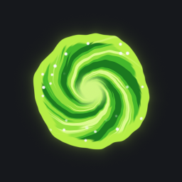
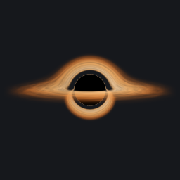
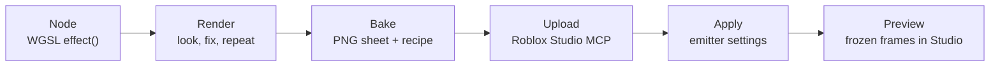

# Roblox VFX Lab

Write a shader, bake it into a Roblox texture, and put it on a ParticleEmitter in Studio. You ask an AI for the effect,
or you write it in the browser; the lab renders it on your GPU, checks it, and exports it to your place.

<p align="center">
  
  
</p>

<p align="center">
  <a href="https://nevelstudios.github.io/roblox-vfx-lab/"><b>Open the lab</b></a> ·
  <a href="#install-the-mcp"><b>Install the MCP</b></a> ·
  <a href="#examples"><b>Examples</b></a>
</p>

## What it is

Roblox runs no custom shaders. A ParticleEmitter, a Beam or a Trail shows a texture, and a flipbook sheet animates
that texture. The lab closes the gap: you write the effect as a small WGSL function, the lab renders it on a real GPU,
bakes the frames into one PNG sheet, and puts that sheet on your emitter with the right flipbook settings.



You can use it in two ways:

- **In the browser** at [nevelstudios.github.io/roblox-vfx-lab](https://nevelstudios.github.io/roblox-vfx-lab/).
  Nothing to install. Open an example, change it, bake it, download the PNG.
- **As an MCP server** for an AI client (Claude Code, Claude Desktop, Cursor). The AI writes and fixes the node,
  reads the quality warnings, and exports the result to Studio. The same lab page runs on your machine and follows
  every change the AI makes.

## Try it in 60 seconds

1. Open [the lab](https://nevelstudios.github.io/roblox-vfx-lab/) in Chrome, Edge, Safari 26 or Firefox 141 on Windows.
2. The gallery plays every example as Roblox plays it. Press **Open** on one.
3. Move a slider in **Parameters**. The live view on the left changes at once.
4. Turn **Auto bake** on. The baked sheet plays beside the live view, frame by frame, as the emitter will show it.
5. Press **Code** to see the node. Examples are read-only: press **Duplicate** to get your own copy, then edit and
   press **Save** (Ctrl+S). The editor colours the WGSL and completes names as you type: the `vfx_` helpers, the
   `params.` of the node and the `vfx.` frame values (Ctrl+Space opens the list, Tab or Enter takes one).
   To delete one of your nodes or bakes, point at it in the list and press **×**.
6. In **Export**, press **Download PNG**. Upload it in Studio (Asset Manager, or the Texture property of an emitter).
7. Press **Copy** under Export and paste the lines into a script, or set the same properties by hand:

```lua
emitter.Texture = "rbxassetid://<your id>"
emitter.FlipbookLayout = Enum.ParticleFlipbookLayout.Grid4x4
emitter.FlipbookMode = Enum.ParticleFlipbookMode.OneShot
```

Your nodes and bakes stay in this browser (IndexedDB). In a private window that blocks storage, the lab still works,
and the header says **Not saving**.

## Install the MCP

You need:

- Node.js 22 or later.
- A GPU with D3D12 (Windows), Metal (macOS) or Vulkan (Linux). The lab renders with Dawn, the WebGPU engine of Chrome.
- Roblox Studio, only to export. The lab uses Roblox's own Studio MCP server for the upload and for every change in
  your place, so it needs no plugin of its own. In Studio, turn on the MCP server in the Assistant's MCP settings
  ([Roblox's guide](https://create.roblox.com/docs/studio/mcp)).

**Claude Code**

```bash
claude mcp add roblox-vfx-lab -- npx -y github:NevelStudios/roblox-vfx-lab
```

**Claude Desktop** (`claude_desktop_config.json`) and **Cursor** (`~/.cursor/mcp.json`)

```json
{ "mcpServers": { "roblox-vfx-lab": { "command": "npx", "args": ["-y", "github:NevelStudios/roblox-vfx-lab"] } } }
```

Restart the client. When the library (`~/roblox-vfx-lab`) has no `shaders/` folder yet, the first start copies the
examples into it. Then try:

> Open the VFX lab page for me, then make a blue electric hit spark for a sword: a 4x4 OneShot sheet, additive.

## Your first effect

This is what a full run looks like. You say what you want; the AI calls the tools.

1. **You:** "Make a shock ring for a ground slam, white so I can tint it, 4x4 OneShot."
2. The AI reads `vfx_guide`, then writes `shaders/impact/slam-ring.wgsl` with `vfx_shader_write`. The answer has the
   compiler's problems with line and column, so a broken node gets fixed before anything renders.
3. It calls `vfx_render` and looks at the frames as one image. It reads the stats under the image (edge alpha,
   coverage, white share) and fixes what the warnings name with `vfx_shader_edit`.
4. You watch on the lab page (`vfx_viewer` gives the URL): every write shows at once, and you can move the sliders
   yourself.
5. `vfx_bake` writes `bakes/impact/slam-ring.png` and its recipe `.json`.
6. **You:** "Upload it and put it on the emitter I selected." The AI calls `vfx_upload` (public, moderated and
   permanent, so it asks first), then `vfx_apply` with the flipbook settings.
7. `vfx_preview` plays the emitter in the Edit viewport and freezes it at chosen moments, so the AI can look at the
   effect in your scene.

On the local page you can do steps 5 and 6 yourself: select a part, an attachment or an emitter in Studio, and press
**Export to Roblox**. The lab asks before it uploads, then sets the texture on the selected emitters, or makes a new
ParticleEmitter under the selected part or attachment.

## Writing nodes

A node is WGSL with one function. `uv` is 0..1 inside the frame, y up. Return straight RGBA: alpha is the shape, and
RGB stays near white so the emitter's `Color` tints it.

```wgsl
fn effect(uv: vec2f) -> vec4f
```

What a node can read:

| Name | Meaning |
| --- | --- |
| `vfx.phase` | 0..1 across the clip. OneShot: the last frame is 1. Loop: 1 is the next loop's frame 0. |
| `vfx.time`, `vfx.duration` | Seconds into the clip, and its length. |
| `vfx.frame`, `vfx.frames` | This frame and the frame count. |
| `vfx.px` | One output pixel in uv units, for crisp edges. |
| `params.<name>` | A value from a `@param` line. |

Parameters are comments. Each one becomes a slider or a colour field on the page:

```wgsl
// @param width f32 0.02..0.3 = 0.12 ring width
// @param tint color = #ffd27a
```

The types are `f32`, `vec2f`, `vec3f`, `vec4f` and `color`, 15 at most. The helpers (all `vfx_`) cover shapes
(`vfx_circle`, `vfx_ring`, `vfx_segment`, `vfx_box`), edges and light (`vfx_fill`, `vfx_glow`), easing, polar
coordinates, hashes, noise (`vfx_noise`, `vfx_fbm`, `vfx_loop_fbm` for seamless loops) and Worley cells. The full
list is in [src/guide.md](src/guide.md).

A ring that grows and fades:

```wgsl
// @param width f32 0.01..0.2 = 0.06
fn effect(uv: vec2f) -> vec4f {
  let p = vfx_center(uv);
  let t = vfx.phase;
  let d = vfx_ring(p, 0.8 * vfx_ease_out(t), params.width * (1.0 - 0.6 * t));
  return vec4f(vec3f(1.0), vfx_fill(d, vfx.px * 1.5) * (1.0 - vfx_ease_in(t)));
}
```

A smoke puff that loops with no jump:

```wgsl
fn effect(uv: vec2f) -> vec4f {
  let p = vfx_center(uv);
  let n = vfx_loop_fbm(p * 2.5, vfx.phase, 1.5, 5);
  let shape = vfx_fill(length(p) - 0.62 - n * 0.22, vfx.px * 2.0);
  return vec4f(vec3f(0.8), shape);
}
```

## Quality rules

Every render and bake measures each frame and warns about the usual faults. The page shows the warnings under
**Bake**; the AI reads them in the tool answer.

- **Keep the shape inside the frame.** Alpha on the frame edge makes a hard cut line in game. The `edge` stat must be
  0 or close to it (the warning starts above 0.02). Only a tiling still for a Beam or a Trail may touch the edge.
- **Nothing ends on a cut.** Fade over a long band (about 0.62 to 0.93 of the radius), and check the bake over the
  light backdrop too.
- **Frame 0 must read alone.** Devices that turn flipbooks off show only frame 0.
- **Every frame changes.** A sheet that grows and then holds plays as a still image.
- **A loop does not jump** from its last frame to its first. Use `vfx_loop_fbm` or `sin(phase * VFX_TAU)`.
- **Little is full white.** A bright core and a fainter body read better than a flat white shape.
- **Fill the frame.** Empty space spends pixels on nothing.

## Roblox export

- `FlipbookLayout` comes from the grid (`Grid2x2`, `Grid4x4`, `Grid8x8`). `FlipbookMode` is `OneShot` (once over the
  particle's Lifetime) or `Loop` at `FlipbookFramerate`.
- Roblox plays a flipbook at 30 fps at most. A loop of 64 frames takes 2.13 s, whatever its duration says. The page
  warns when a loop goes over 30 fps.
- `LightEmission` 1 is additive: dark pixels vanish, good for light. 0 is alpha blend: the alpha shape shows, good
  for smoke and ink.
- A flipbook plays only on a ParticleEmitter. A Beam or a Trail takes a still: bake it with margin 0 so it tiles
  along the beam, then scroll it with `TextureSpeed`.
- Roblox scales images above 1024 px down. A still that must be sharper (a big sky object) bakes with `tiles` 2..4
  into several 1024 PNGs, laid out as ImageLabels in one BillboardGui.

## Examples

Every example ships as a node, a baked PNG and its recipe in [examples/](examples). Download them from the gallery,
or use them in your own place as they are.

| Preview | Example | Sheet | Target |
| --- | --- | --- | --- |
|  | [Green portal](examples/portal/green-portal.wgsl): a lumpy green disk with painted spiral arms that wind into a bright eye, a lime rim and white specks | 4x4 loop, 1.5 s | ParticleEmitter, LightEmission 0.2 |
|  | [Black hole](examples/space/black-hole.wgsl): ray-traced; a thick accretion disk lensed over and under the shadow, Doppler beaming and a photon ring | 4x4 loop, 2 s | ParticleEmitter, LightEmission 0 |

## Tools reference

| Tool | What it does |
| --- | --- |
| `vfx_guide` | The node rules, helpers, quality rules and Roblox settings, by topic. |
| `vfx_shader_list` | Every node in the library with its hash and state. |
| `vfx_shader_read` | One node's source, hash, problems and parameters. |
| `vfx_shader_write` | Creates or replaces a node (`replaces` names the hash it overwrites). |
| `vfx_shader_edit` | Changes a node by exact text replacements, all or nothing. |
| `vfx_render` | Renders frames, chosen phases or a parameter sweep as one image, with stats and warnings. |
| `vfx_bake` | Writes the final PNG (still or 2x2, 4x4, 8x8 sheet at 256, 512 or 1024) and its recipe. |
| `vfx_upload` | Uploads a bake through Roblox's Studio MCP and records the asset id. |
| `vfx_apply` | Sets the texture and flipbook settings on instances, or makes a new emitter. |
| `vfx_preview` | Plays emitters in the Edit viewport and freezes them at chosen moments for screenshots. |
| `vfx_delete` | Deletes a node or a bake (its PNG and recipe) from the library. |
| `vfx_viewer` | Starts the local lab page and answers its URL. |

## Configuration

| Variable | Default | Meaning |
| --- | --- | --- |
| `VFX_LAB_LIBRARY` | `~/roblox-vfx-lab` | The library folder: `shaders/` for nodes, `bakes/` for PNGs and recipes. |
| `VFX_LAB_PORT` | `4518` | The port of the local lab page (127.0.0.1 only). |
| `ROBLOX_STUDIO_MCP` | Windows: `cmd.exe /c %LOCALAPPDATA%\Roblox\mcp.bat`<br>macOS: `/Applications/RobloxStudio.app/Contents/MacOS/StudioMCP` | The command that starts Roblox's Studio MCP. Use double quotes around a path with spaces. |

## Troubleshooting

**`no GPU adapter: Dawn found no D3D12, Vulkan or Metal device`.** The machine has no GPU the lab can use (a VM or a
server with no GPU driver). Update the GPU driver, or run the lab on a machine with a GPU.

**`no Roblox Studio MCP found at ...`.** Studio is not installed, or it never ran on this account. Install Studio and
open it once. If Studio is somewhere else, set `ROBLOX_STUDIO_MCP` to the command that starts its MCP server.

**`Roblox's Studio MCP did not start` or `exited`.** Open Studio with a place, and turn on its MCP server in the
Assistant's MCP settings. The next call starts the Studio MCP again.

**`no Studio is connected: open a place in Roblox Studio`.** The Studio MCP runs, but no place is open. Open one.
With two Studio windows open, the page asks which one to use.

**macOS.** The lab looks for the Studio MCP at `/Applications/RobloxStudio.app/Contents/MacOS/StudioMCP`. If Studio
is in another folder, set `ROBLOX_STUDIO_MCP`.

**`port 4518 is taken by another program`.** Set `VFX_LAB_PORT` to a free port. A lab that already runs on that port
is used as it is.

**The page says the browser has no WebGPU.** Use Chrome, Edge, Safari 26 or Firefox 141 on Windows. Without WebGPU,
the gallery and finished bakes still play, but nodes do not render live and bakes do not run.

**Windows: the client cannot start `npx`.** Some clients start commands without a shell. Use
`"command": "cmd", "args": ["/c", "npx", "-y", "github:NevelStudios/roblox-vfx-lab"]`.

**The hosted lab and other NevelStudios pages.** Every page under `nevelstudios.github.io` shares one browser origin,
so they share storage. The lab keeps its data in the IndexedDB database `roblox-vfx-lab` and in `vfx:` keys.

## How it works

- **GPU worker.** The MCP renders with Dawn (the `webgpu` package) in a child process. Dawn prints errors on stdout
  and a runaway shader can hang the device, so the child keeps both away from the MCP stream. A call over 60 s stops
  the worker, and the next call starts a new one.
- **Shared modules.** `src/core.js` (parameters, shader assembly, layout), `src/pixels.js` (dilate, stats, PNG and
  APNG) and `src/bake.js` (the bake itself) have no Node APIs. The MCP and the browser run the same code, so a sheet
  baked in the browser has the same pixels as one baked by the MCP.
- **Local mode.** `vfx_viewer` starts the page on 127.0.0.1. The page reads and writes the library on disk, and a
  file watcher pushes every change to the page. Only the page's own origin can post to it.
- **Hosted mode.** On GitHub Pages there is no server. The examples are read-only files of the site, your nodes and
  bakes live in IndexedDB, and bakes run on the browser's WebGPU. Export to Roblox needs the Studio MCP, so it runs
  only on the local page.
- **Studio.** The lab starts Roblox's Studio MCP as a child process at the first call that needs Studio, and talks to
  it with `list_roblox_studios`, `upload_image`, `execute_luau` and `screen_capture`. The Luau it runs is fixed code
  in `src/studio-ops.luau`; your values reach it as data, never as code.

## Contributing

```bash
npm ci
npm test
npm run smoke
```

`npm test` runs the unit tests (no GPU needed). `npm run smoke` bakes every example on your GPU and checks that each
one is clean. `npm run examples` writes the example PNGs, recipes and previews again after you change a node.

Issues and pull requests are welcome. Keep new examples original, with no warnings in their bake.

## License

MIT, see [LICENSE](LICENSE). Made by [Nevel Studios](https://github.com/NevelStudios).
